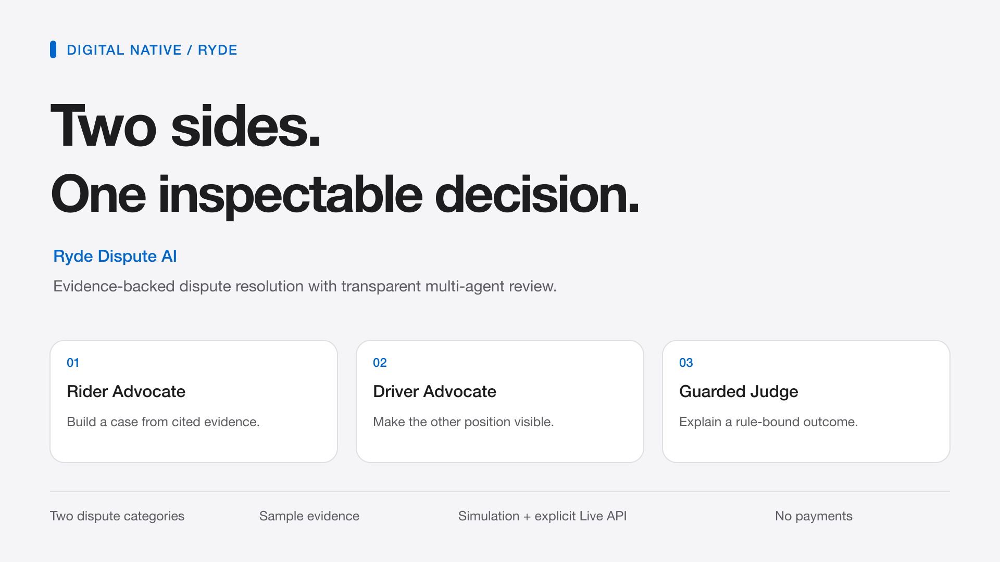

# Ryde Dispute AI

**Evidence-backed dispute resolution, visible from claim to decision.**

Digital Native / Ryde track · Tencent Cloud × AI Singapore Hackathon 2026.



A dispute review workbench for route deviation and no-show charges. Rider and Driver Advocates select cited evidence; a Judge explains the policy-constrained result. The program controls amounts, handles missing evidence, and preserves an inspectable audit trail. Recommendations do not execute payments.

## Run the simulation

Python 3.12 is the verified runtime. From the repository root:

```bash
python3 -m venv .venv
.venv/bin/python -m pip install -r requirements-dev.txt
OPENAI_API_KEY= LLM_API_KEY= .venv/bin/python -m uvicorn backend.main:app --host 127.0.0.1 --port 8766
```

Open [the local workbench](http://127.0.0.1:8766). Select a case and click **Run simulation**. No API key is required. This mode uses a local simulation provider through the real backend and never sends model requests. The environment overrides above also disable Live API availability, even if a local `.env` exists.

Choose four provider scenarios: all agents succeed; rider references rejected; invalid draft repaired; provider failure. Compare the individual agent status and attempt count, open evidence/policy citations, then download the audit JSON. Samples and demo policies are explicitly labelled. Real-model smoke results and limitations are in the [Live API report](docs/reports/WB02-LIVE.md); real evidence authenticity has not been evaluated.

| Sample | Expected recommendation |
|---|---|
| RYDE-2026-0001 · route deviation | Manual review · route consent unconfirmed; amount unavailable |
| RYDE-2026-0002 · no show | Full refund · SGD 5.00 |
| RYDE-2026-0003 · no show | No action · SGD 0.00 |
| DISP-002 · organiser-format example | No action · SGD 0.00 |
| DEMO-ORAL-AGREED · synthetic | Both parties report agreement; no separate stop dispute |
| DEMO-ORAL-CONFLICT · synthetic | Conflicting statements; manual review, no automatic amount |
| DEMO-ORAL-NOT-AGREED · synthetic | Both parties report no agreement; rule refund SGD 7.87 |

Click a sample case card to select it and expand its full statement in place. Other cards keep a compact preview. Clicking the already loaded case again preserves its current result or run.

## Interface language

Use the **中文 / English** selector in the header. A saved choice takes priority; otherwise, a Chinese browser locale starts in Chinese and other locales start in English. The page remembers the choice when browser storage is available. Switching only changes presentation: it does not rerun a case, call a model, change the amount, or change Simulation / Live API mode.

Controls, status labels and fixed system guidance are bilingual. Chinese rulings include a summary of the structured result. Party statements, chats, cited evidence, original explanations and audit JSON retain their source content; unfamiliar returned text stays in its original language. This preserves the distinction between translated interface guidance and evidence.

## Consent and evidence limits

Both parties can supply `route_consent` as `agreed`, `not_agreed` or `unknown` through the structured case API. The system compares these statements as consistent, conflicting or unconfirmed. Agreement between statements is not independent verification; GPS and missing chat never establish oral consent. Where unresolved consent would change responsibility or the refund, the recommendation is held for manual review with no automatic amount and explicit follow-up questions. Sufficient objective evidence in unrelated cases can still produce a recommendation.

The UI selects predefined samples; it has no case upload or manual-entry form and no persistent new-case list. `/api/resolve` accepts structured cases. The route picture is a schematic of supplied coordinates, and deviation uses supplied baseline and actual distances. Traffic flags are inputs, with no map-provider or historical traffic verification. Manual review is a status flag only: there is no customer-support dispatch integration.

The three `DEMO-ORAL-*` records are explicitly synthetic variants; the original supplied case texts are unchanged. Under the new demo policy, original case 0001 no longer automatically refunds SGD 7.87 because relevant oral agreement remains unconfirmed. Historical reports describe the earlier rules. The interface follows [official Ryde visual references](docs/sources/2026-10-16-ryde-brand.md), while remaining a clearly labelled hackathon prototype.

## Run with DeepSeek

Copy `.env.example` to a local `.env`, enter your own `LLM_API_KEY`, and set `LLM_LIVE_ENABLED=true`. Keep the confirmed official destination, model, thinking and JSON settings from the example. `.env` is ignored by Git; never put its contents in screenshots or shared documents. Remove conflicting `OPENAI_*` environment overrides, which take priority. Restart the server after configuration changes:

```bash
.venv/bin/python -m uvicorn backend.main:app --host 127.0.0.1 --port 8766
```

The page still starts in **Simulation**. Select a sample, change **Run mode** to **Live API**, and click **Run live API**. Three real agents select evidence, with at most one retry per agent and six requests per run. A transport failure stops further outbound requests in that run. Per-agent usage and rejected drafts remain visible; a fallback is never labelled model success. Audit exports record the execution mode. Live models still use sample evidence and demo policies, with no payment execution.

For a separately authorized, bounded one-case verification:

```bash
.venv/bin/python -m backend.live_smoke --live --confirm-base-url https://api.deepseek.com --case RYDE-2026-0001 --output /tmp/ryde-live-smoke.json
```

Each explicit run may incur charges. Request and token limits apply per run; there is no account-wide spending cap. Provider settings follow the [official DeepSeek API documentation](https://api-docs.deepseek.com/).

## Verify offline

```bash
OPENAI_API_KEY= LLM_API_KEY= .venv/bin/python -m pytest -o addopts= -q
OPENAI_API_KEY= LLM_API_KEY= .venv/bin/python -m backend.evaluate --output /tmp/ryde-evaluation.json
```

Frontend behaviour tests need Node.js on PATH (or the bundled Codex Node runtime discovered by the test harness). The frozen evaluation expects actions, amounts, escalation and retry states independently of actual results. Passing means consistency on these fixtures, not real-world model accuracy.

## Project map

- `backend/agents/`: role responsibilities and orchestration.
- `backend/core/`: evidence, policy, output guard, provider, simulation, events and case tools.
- `backend/adapters/`: organiser-format normalization and conflict handling.
- `backend/prompts/`: versioned role instructions and strict evidence-selection contracts.
- `frontend/`: accessible single-page workbench, incremental run events, citation inspection and export.
- `sample_data/evaluation/`: frozen independent expectations; `tests/`: regressions.

Runtime is deliberately local and single process: up to 2 active runs, 50 retained runs, memory cleared on restart. It has no durable history, account isolation or real payment integration. `/api/runs` is simulation-only; legacy `/api/resolve` always uses offline fallback. Only `/api/live-runs` enables paid browser runs, gated by an explicit live flag and confirmed destination. Keep this development server bound to localhost.

## Demo and project records

Start with the [submission pack](docs/submission/README.md), [demo script](docs/submission/DEMO.md), [architecture](docs/submission/architecture.svg), and [verification report](docs/reports/WB03-WB04.md). Current ownership and next steps live only in [STATUS](docs/STATUS.md); requirements and submission gaps in [REQUIREMENTS](docs/REQUIREMENTS.md). Original project collaboration rules remain in [AGENTS](AGENTS.md).

## Submission materials

The final implementation is available on [`main`](https://github.com/luoziming49-ops/ryde-hackathon). Branch selection, validation and the integration record are documented in the [final release report](docs/reports/FINAL-RELEASE.md). PR #5 merged the reviewed integration into the default branch.

Start with the [submission package](docs/submission/README.md): English form copy, a six-minute walkthrough, PNG cover and architecture diagram, and prompts for small, genuine WorkBuddy review tasks. Those prompts are not evidence of completed tool use. Real conversation screenshots and the official form receipt remain to be supplied.

The October 16 presentation refresh uses a light, restrained interface with system fonts and responsive content hierarchy. Automated regression results and any remaining browser checks are recorded in the [submission closeout report](docs/reports/SUBMISSION-FINAL.md).
