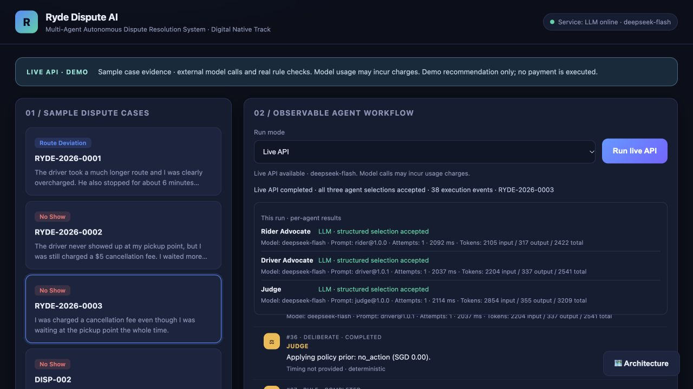

# WB02-LIVE：DeepSeek真实接入验收

2026-10-14 · CP-017 · 基线3ca40cf · 负责人：协调助手。结论：真实API及工作台主路径已接通；受控样例验证完成，模型稳定性仍需扩测。模拟MVP先行的历史验收保留在[WB03/WB04](WB03-WB04.md)。

## 配置与授权

用户确认服务商为DeepSeek，随后明确批准四个既有演示案件的证据目录、演示政策和代理提示词发送至官方`https://api.deepseek.com`，模型`deepseek-flash`；整轮含重试、诊断及浏览器验证最多30次请求、费用上限US$1。范围见调用前生成的[outbound-manifest](assets/wb02-live/outbound-manifest.json)；该文件的0次计数是预检时点，不是本轮总量。首次请求曾被自动审批拦截，未发出；明确授权后才执行。

本地`.env`已配置、权限0600、被Git忽略；不保存凭据到浏览器、共享文档或验收附件。公开配置示例在仓库`.env.example`，启动与操作见根README。当前电脑无需用户再配置。采用显式关闭thinking、结构化请求JSON模式；这些参数与兼容地址依据[官方API入口](https://api-docs.deepseek.com/)和[Chat Completion文档](https://api-docs.deepseek.com/api/create-chat-completion/)，于本轮核验。

## 实测：不将回退计作模型成功

| 顺序 / 输入 | 真正HTTP请求 | 三代理全部合格 | 金额 / 动作 | 耗时 | 原始统计 |
|---|---:|---|---|---:|---|
| 首案 RYDE-2026-0001 | 3 | 是 | 部分退款 SGD 7.87 | 5928ms | [首案](assets/wb02-live/first-smoke.json) |
| RYDE-2026-0002 | 3 | 是 | 全额退款 SGD 5.00 | 5018ms | [第二案](assets/wb02-live/RYDE-2026-0002.json) |
| RYDE-2026-0003 | 4 | 否：司机两次被拒，回退 | No action SGD 0.00 | 6946ms | [原始失败](assets/wb02-live/RYDE-2026-0003.json) |
| DISP-002 | 3 | 是 | No action SGD 0.00 | 5851ms | [官方格式样例](assets/wb02-live/DISP-002.json) |
| 浏览器复现第三案，旧提示词 | 4 | 否：司机两次被拒，回退 | No action SGD 0.00 | 8747ms | [浏览器失败](assets/wb02-live/browser-rejection.json) |
| 浏览器第三案，driver@1.0.1 | 3 | 是，每个代理一次 | No action SGD 0.00 | 6253ms | [修订后通过](assets/wb02-live/browser-live-accepted.json) |
| 绕路案复测，driver@1.0.1 | 3 | 是，每个代理一次 | 部分退款 SGD 7.87 | 5707ms | [跨类别复测](assets/wb02-live/route-prompt-1.0.1.json) |

初轮为四案业务动作/金额均一致、其中3/4三代理全部合格。没有把第四案中的确定性回退算作真实模型通过。两个额外司机诊断共3次请求：[独立诊断](assets/wb02-live/driver-diagnostic.json)一次通过；[完整上下文诊断](assets/wb02-live/driver-diagnostic-full-context.json)首次明确捕获`invalid_evidence_reference`，司机陈述`driver.response`的文本被改写，其余五条派生证据逐字一致，第二次重试通过。

依据这个实测原因，只将司机提示词升级到1.0.1，强调复制目录`text`的前缀、标点、引号和空白，JSON转义保持解码后原文一致，不改写或直接复制原始value；没有修改Guard或退款规则。修订后的两个完整复测均通过，不能据此声称已消除所有随机拒绝。其余两案未用新提示词再次付费重跑，保留初轮结果。失败与诊断附件均未覆盖或删除。

## 用量与费用

累计 **26次实际HTTP请求**，已停止本轮调用。服务商返回完整用量：60,639 input、8,081 output、68,720 total tokens，包含失败尝试与诊断。[逐次汇总](assets/wb02-live/usage-summary.json)可复核。

按核验时[官方价格表](https://api-docs.deepseek.com/quick_start/pricing/)的峰时缓存未命中input US$0.30/百万、output US$1.20/百万，保守估算 **US$0.0278889（约0.028美元）**。未应用缓存命中或非峰时优惠，未取得实际账单；这不是已扣费金额。远低于本轮US$1授权预算。应用限制是每次运行最多6请求、单次消息正文60,000 UTF-8字节、最多1,800输出token，传输错误后停止该运行后续外发；不是账户级美元硬限额，也不授权无人值守持续调用。

## 实现与验证

- 浏览器默认Simulation；需要显式选Live API。真实入口`POST /api/live-runs`仅接收已知样例case_id，检查开启标志、确认目的地址及浏览器Origin；每次运行独立provider，事件和导出准确标注模式。后台持有凭据。
- 服务商用量按尝试累加；缺失、部分或格式错误用量不会被显示成完整零值。逐代理拒绝、重试、耗时和fallback保留。不能由总健康徽章推断某轮全部成功。
- 原有`/api/runs`继续离线模拟。独立审查发现旧`/api/resolve`能绕过真实开关后，已将旧接口三种输入路径统一为显式离线回退，并保留原响应结构。
- 非法模型配置曾导致health失败，现返回安全的配置错误状态并禁用Live，模拟模式仍可用。两项问题均先复现，修复后由独立审查复验，无剩余阻塞。
- 最终离线回归 **362 passed in 1.90s**，包含新增用量、配置、接口边界、前端模式切换、陈述逐字一致的回归；冻结预期评测 **25/25**，见[本轮评测](assets/wb02-live/offline-evaluation.json)。单元测试隔离凭据，未发真实请求。
- 真正浏览器验证默认模式、实时事件、失败明确回退、修订后的三个真实代理全部合格、用量与金额、切回模拟清除旧结果及零真实请求的模拟运行。浏览器warn/error日志为空。当前版本导出的模式及用量通过前端自动化验证，本轮没有重复触发浏览器下载。

验证命令：

```bash
OPENAI_API_KEY= LLM_API_KEY= .venv/bin/python -m pytest -o addopts= -q --tb=short
OPENAI_API_KEY= LLM_API_KEY= .venv/bin/python -m backend.evaluate --output docs/reports/assets/wb02-live/offline-evaluation.json
```



[旧提示词回退截图](assets/wb02-live/browser-rejection.png) · [切回模拟截图](assets/wb02-live/browser-simulation.png)

## 当前边界与接续

模型是真实服务；证据、政策仍为演示输入，没有接入真实Ryde证据服务或支付。程序决定业务动作和金额，模型选择可追溯的证据；不把小样本一致性称为准确率或业务收益。运行记录仅在单进程内存中，重启清空；无账户隔离或持久化，不是生产部署。

下一步优先补赛事真实工具使用证明、最新赛务和展示材料；按需要增加不同输入与重复运行的稳定性评估，并沿用显式调用授权。代码保留本地分支，不推送、不合并同伴PR、不部署、不正式提交。参赛检查入口见[交付包](../submission/README.md)。
